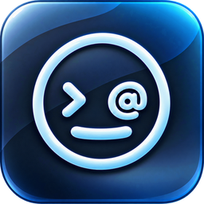
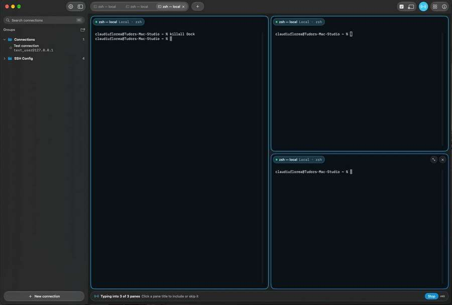
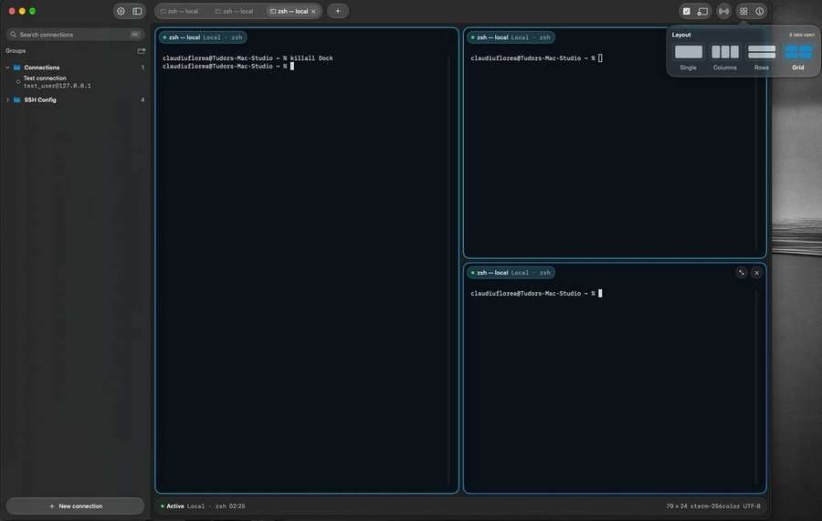
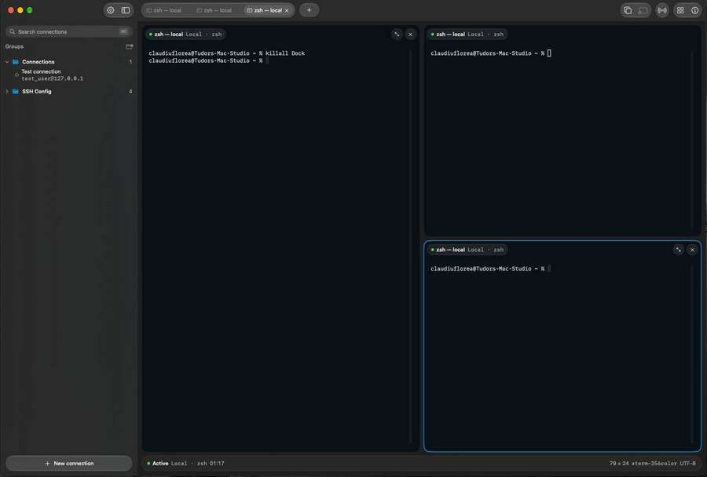
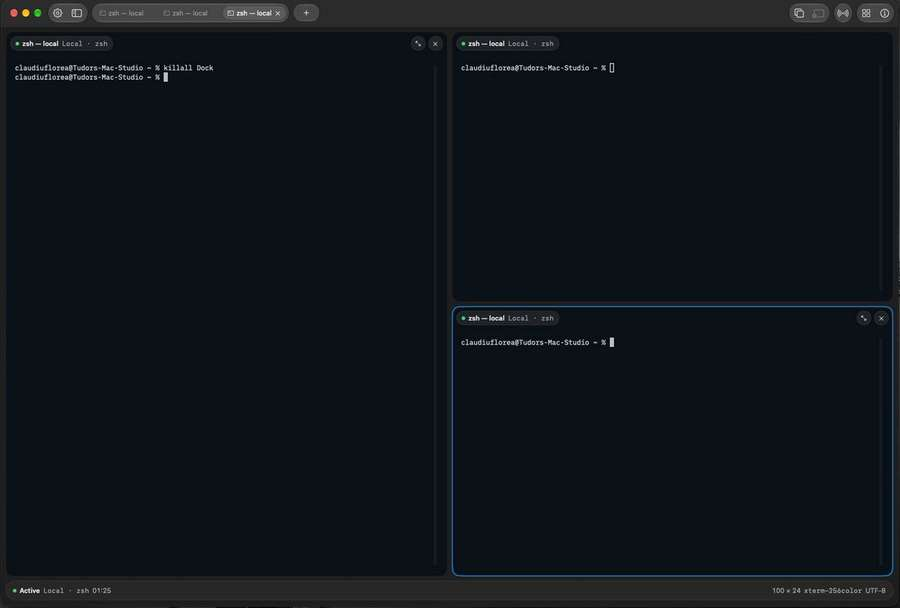
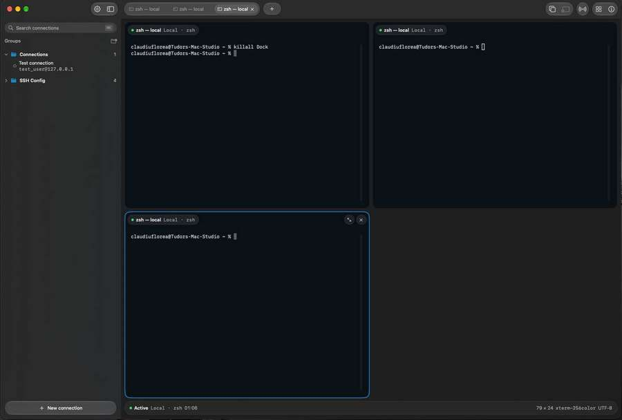
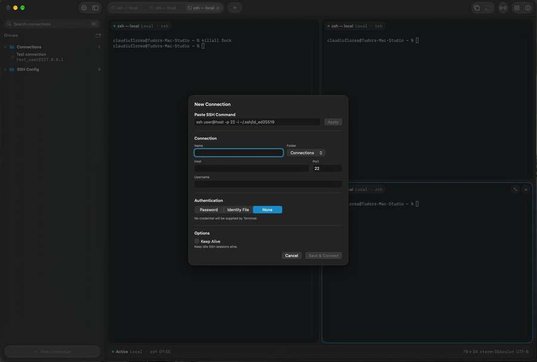
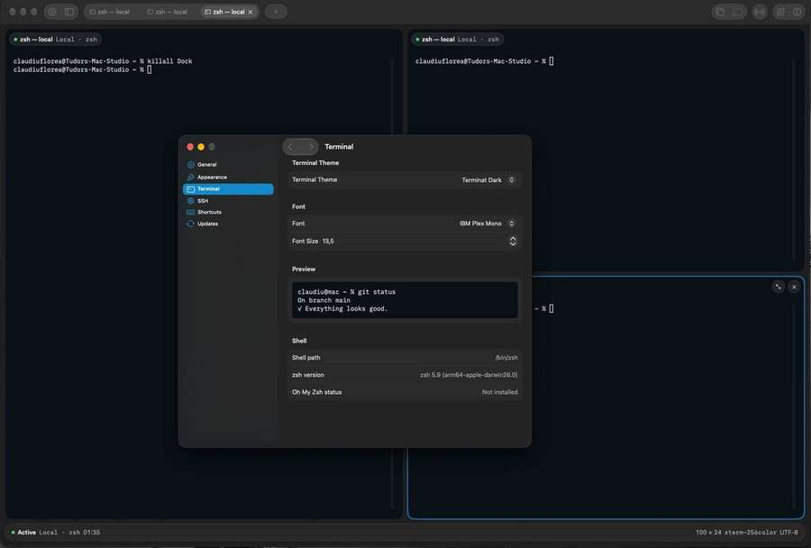

<p align="center">
  
</p>

<h1 align="center">Terminat</h1>

<p align="center">
  <strong>Native macOS terminal and SSH client with saved connections, flexible layouts, Broadcast Input, and secure Keychain credentials.</strong>
</p>

<p align="center">
  <a href="https://github.com/ClaudiuFlorea/Terminat/releases/latest"><strong>Download Terminat 2.0.0</strong></a>
  · macOS 26.3+
  · Developer ID signed & Apple notarized
</p>

<p align="center">
  
</p>

## Why Terminat

Terminat is built for people who live in terminals but want a native macOS workflow. It combines real local `zsh` sessions, saved SSH connections, system OpenSSH, secure Keychain credentials, flexible pane layouts, and multi-session Broadcast Input in one keyboard-first app.

There is no Terminat account, cloud backend, advertising SDK, or browser-based terminal layer.

## Workspace

<table>
  <tr>
    <td width="50%">
      <br>
      <strong>Flexible layouts</strong><br>
      Switch between Single, Columns, Rows, and Grid without restarting sessions.
    </td>
    <td width="50%">
      <br>
      <strong>Resizable Grid</strong><br>
      Resize rows and columns, expand panes, and keep session order intact.
    </td>
  </tr>
  <tr>
    <td width="50%">
      <br>
      <strong>Focused workspace</strong><br>
      Hide the sidebar when you want the whole window for active sessions.
    </td>
    <td width="50%">
      <br>
      <strong>Persistent grid structure</strong><br>
      Grid capacity stays stable while terminals open and close during the current workspace.
    </td>
  </tr>
</table>

## Broadcast Input

Select multiple terminal panes and send the same raw terminal input to all selected targets.

Useful for repeating commands across several machines or sessions without copy/paste loops.

- visually distinct selected and active Broadcast states
- disconnected sessions are excluded automatically
- input is forwarded at terminal-input level
- normal text, Enter, Backspace, Tab, arrows, Escape, and supported control sequences are preserved

| Shortcut | Action |
| --- | --- |
| **⌘1…⌘9** | Focus terminal 1…9 |
| **⇧⌘+** | Add current terminal to Broadcast selection |
| **⇧⌘-** | Remove current terminal from Broadcast selection |
| **⇧⌘B** | Toggle Broadcast Input |

## SSH without replacing OpenSSH

Terminat uses macOS' system `/usr/bin/ssh` rather than implementing its own SSH stack.

That means your normal OpenSSH environment continues to work, including `~/.ssh/config`, `known_hosts`, SSH agent, identity files, ProxyJump / ProxyCommand, and other OpenSSH-managed options.

<p align="center">
  
</p>

Saved connections support:

- name, host, port, and username
- Password, Identity File, or None authentication modes
- optional SSH Keep Alive
- paste/import of a normal `ssh user@host ...` command
- folders and drag-and-drop organization
- search across saved connections and SSH-config entries

SSH config entries remain read-only in Terminat and can be copied into Saved Connections when you want to manage them inside the app.

## Secure credentials

Saved SSH passwords are stored in **macOS Keychain**.

They are not stored in connection JSON files, UserDefaults, command-line arguments, or logs.

Terminat's AskPass flow uses a private local Unix-domain socket and validates the requesting process before the main app reads a password from Keychain.

See [SECURITY.md](SECURITY.md) for implementation details.

## Native appearance

Terminat is a native SwiftUI/AppKit macOS application with light/dark application themes, terminal themes, installed monospace font selection, live font sizing, and native Settings.

<p align="center">
  
</p>

## Local terminal

- real local `zsh` sessions through a PTY
- independent terminal sessions
- ANSI colors and interactive CLI applications
- standard copy/paste and scrolling
- Control commands, Tab, arrows, Escape, and shell key combinations
- terminal title and size/status metadata

## Keyboard shortcuts

| Shortcut | Action |
| --- | --- |
| **⌘T** | New Local Shell |
| **⌘W** | Close current terminal session |
| **⌘1…⌘9** | Focus terminal 1…9 |
| **⌘←** | Previous terminal |
| **⌘→** | Next terminal |
| **⇧⌘+** | Add current terminal to Broadcast selection |
| **⇧⌘-** | Remove current terminal from Broadcast selection |
| **⇧⌘B** | Toggle Broadcast Input |
| **⇧⌘L** | Cycle layout |
| **⌘K** | Focus connection search |
| **⇧⌘S** | Toggle sidebar |
| **⌘,** | Settings |
| **⌘Q** | Quit |

## Download

Download the latest signed and notarized DMG from **[GitHub Releases](https://github.com/ClaudiuFlorea/Terminat/releases/latest)**.

Current release: **2.0.0**

Requires **macOS 26.3 or later**.

## Updates

Terminat uses Sparkle 2 for signed application updates.

Existing GATE22 1.x installations can update directly to Terminat 2.0.0 through the legacy GATE22 feed. After that migration, Terminat uses this repository's update feed for future releases.

Updates are protected by Sparkle EdDSA signatures in addition to Apple Developer ID signing and notarization.

## Privacy

Terminat is local-first and currently has no Terminat user account, cloud sync, backend, or advertising SDK.

Network access is used for SSH sessions explicitly opened by the user, Sparkle update checks/downloads, and network activity initiated by commands running inside terminal sessions.

See [PRIVACY.md](PRIVACY.md).

## Release integrity

**Terminat 2.0.0**

```text
SHA-256
c08d4e0ed2c3a8db09b1ec274cccfbb97b42549a3dc079a4fcae9663a7a77f8d
```

The release DMG is Developer ID signed, built with Hardened Runtime, Apple notarized, and stapled.

## Public repository

Terminat is closed-source software.

This repository contains release downloads, Sparkle update metadata, changelog, security/privacy documentation, and product screenshots. The application source code is maintained privately.

See [CHANGELOG.md](CHANGELOG.md) for release history.
